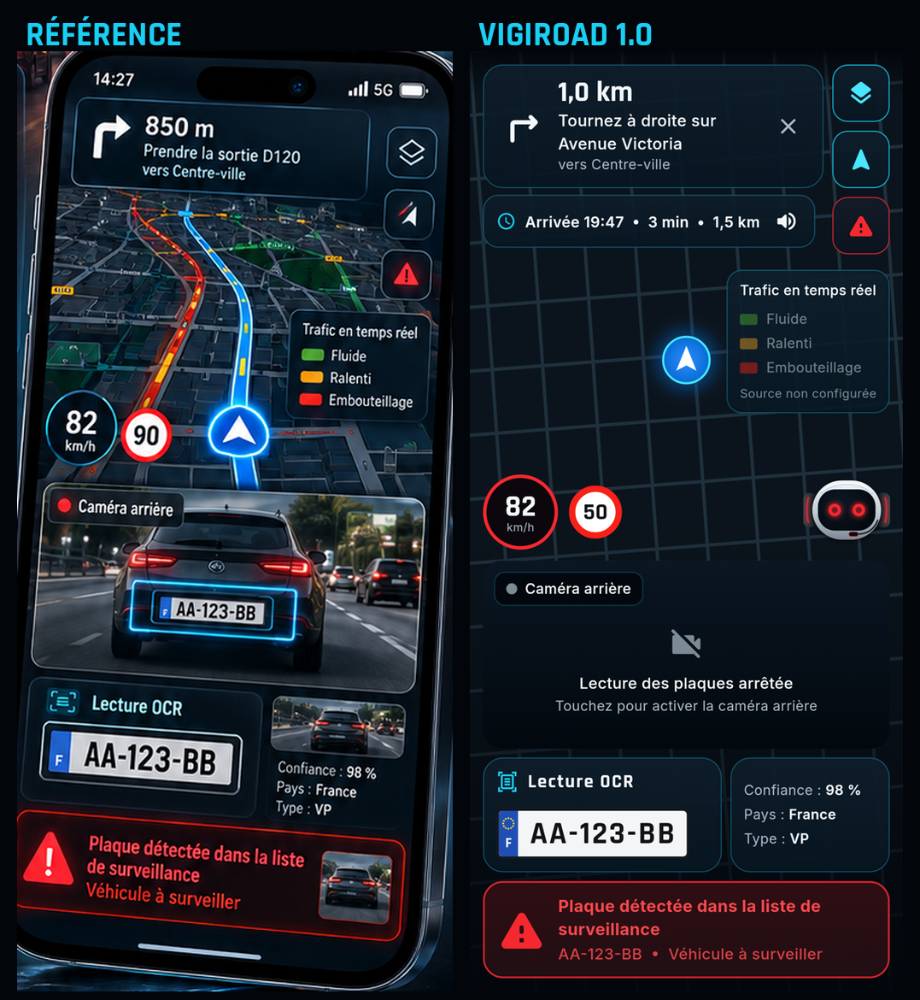

# VIGIROAD

GPS mobile intelligent avec lecture automatique des plaques d'immatriculation et assistant vocal **SENTRIX**.
Android et iOS, interface DARK premium.

| | |
|---|---|
| **Version** | 1.0.0 |
| **Framework** | Flutter 3.47.9 / Dart 3.13 |
| **État** | Riverpod 3 |
| **Carte** | MapLibre GL + données OpenStreetMap |
| **Itinéraires / adresses** | API compatibles OSRM / Photon (configurables) |
| **Caméra / OCR** | plugin `camera` (CameraX / AVFoundation) + Google ML Kit, analyse sur l'appareil |
| **Données** | SQLite chiffré (SQLCipher), clé dans le trousseau sécurisé |
| **Voix** | `speech_to_text` + `flutter_tts` (moteurs du système) |

## Version 1.0

| Phase | Contenu | État |
|---|---|---|
| 1 | Initialisation, architecture, CI | ✅ |
| 2 | Interface DARK fidèle à la référence | ✅ |
| 3 | GPS et guidage | ✅ |
| 4 | Caméra et lecture des plaques | ✅ |
| 5 | Base de plaques et alertes | ✅ |
| 6 | SENTRIX et moteur vocal | ✅ |
| 7 | Intégration simultanée | ✅ |
| 8 | Historique et paramètres | ✅ |
| 9 | Tests et optimisation | ✅ (tests sur appareil à réaliser) |
| 10 | Livraison 1.0 | ✅ |

**156 tests automatiques, 81 % de couverture.** Fonctionnalités et limitations :
[`docs/RELEASE_NOTES_1.0.md`](docs/RELEASE_NOTES_1.0.md).



## Installer

Android 7.0+ : télécharger `vigiroad-1.0.0-arm64.apk` depuis la release **v1.0.0** (page *Releases*)
et l'ouvrir sur le téléphone. iOS et compilation : [`docs/INSTALL.md`](docs/INSTALL.md).

## Compiler soi-même

Prérequis : Flutter 3.47.9 (canal stable), Android Studio (SDK Android, JDK 21) ; pour iOS, un Mac avec Xcode et CocoaPods.

```bash
git clone https://github.com/hempreur/VIGIROAD.git && cd VIGIROAD
flutter pub get
flutter run --dart-define-from-file=config/dev.env          # téléphone branché
flutter build apk --release --dart-define-from-file=config/prod.env
flutter build ipa --dart-define-from-file=config/prod.env   # Mac uniquement, signature requise
```

La configuration est décrite dans [`.env.example`](.env.example) et [`docs/API_CONFIG.md`](docs/API_CONFIG.md).
Aucune clé n'est nécessaire avec la pile actuelle ; les fichiers `config/*.local.env` sont ignorés par git
pour y placer d'éventuelles valeurs privées.

## Tests

```bash
flutter analyze
flutter test --exclude-tags screenshots                   # tests unitaires et widgets
flutter test --tags screenshots --update-goldens          # régénère les captures d'écran
```

La CI (`.github/workflows/ci.yml`) exécute l'analyse, les tests, génère les captures,
compile l'APK Android et un build iOS non signé à chaque push et Pull Request.

## Organisation Git

- `main` : branche stable, alimentée uniquement par Pull Request.
- `feature/<phase>-<sujet>`, `fix/<sujet>` : développement.
- `ci-logs/*` : journaux et captures publiés automatiquement par la CI (ne pas modifier).
- Pré-release `apk-dev` : dernier APK de test compilé par la CI.

## Documentation

- [Guide d'installation](docs/INSTALL.md)
- [Architecture](docs/ARCHITECTURE.md)
- [Design system et fidélité à la référence](docs/DESIGN.md)
- [Configuration des services](docs/API_CONFIG.md)
- [Feuille de route et limitations](docs/ROADMAP.md)
- [Rapport de tests](docs/TEST_REPORT.md) · [Protocole sur appareil](docs/DEVICE_TEST_PROTOCOL.md)
- [Captures et comparaison](docs/SCREENSHOTS.md)
- [Notes de version 1.0](docs/RELEASE_NOTES_1.0.md)
- [Module OCR](docs/OCR.md)
- [Assistant SENTRIX](docs/SENTRIX.md)
- [Format de la base de plaques](docs/PLATES_FORMAT.md)
- [Données personnelles et cadre légal](docs/PRIVACY.md)

## Licences tierces

Polices Rajdhani et Inter sous SIL Open Font License 1.1 (`assets/fonts/OFL.txt`).
Données cartographiques © contributeurs OpenStreetMap (ODbL), style © CARTO.
