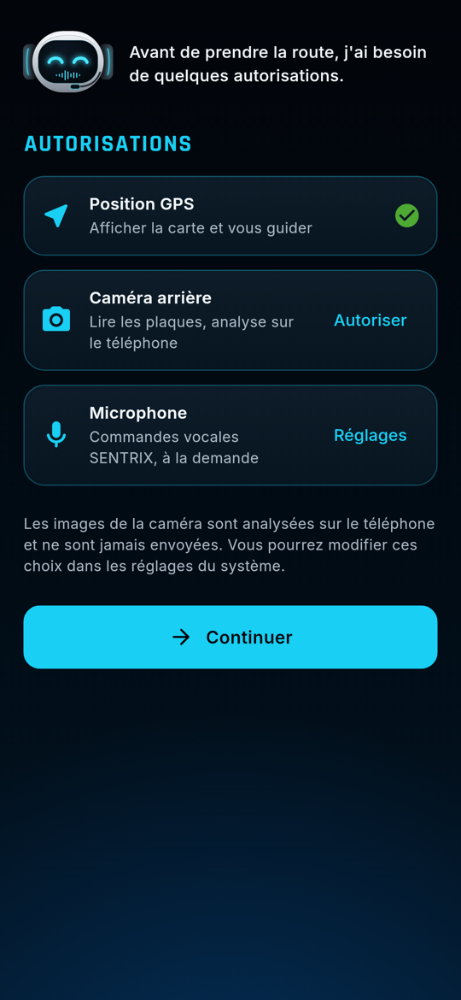
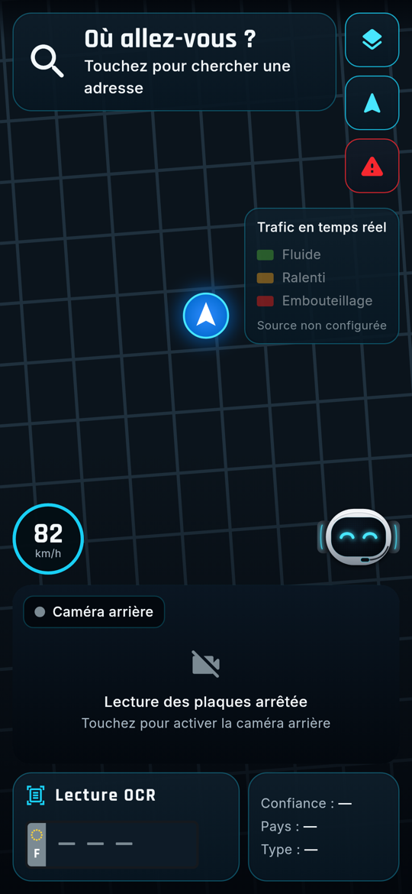
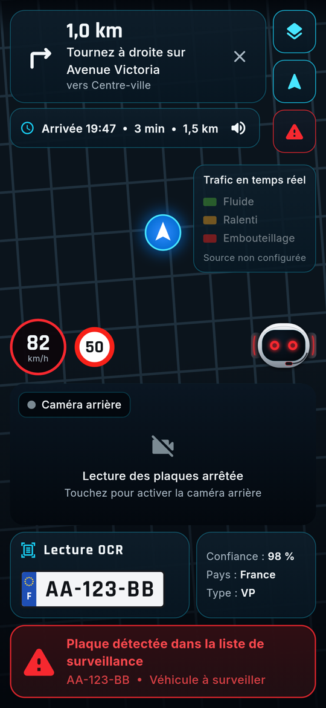
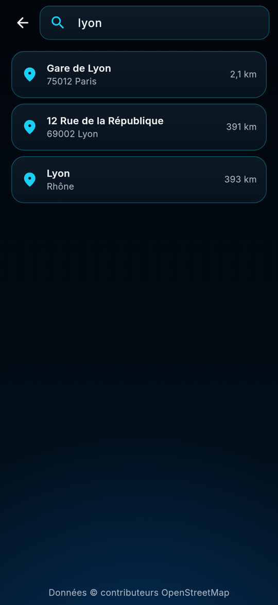
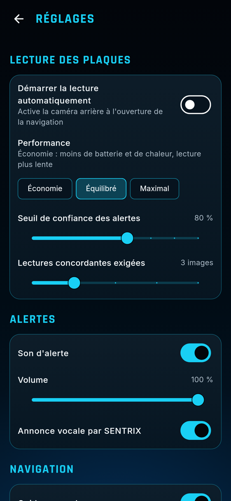

# Captures d'écran et comparaison avec la référence

## Correspondance avec l'image de référence

| Élément de la référence | VIGIROAD 1.0 |
|---|---|
| Cartouche de manœuvre (flèche, distance, consigne, direction) | ✅ identique dans sa composition, données réelles OSRM |
| Colonne de 3 boutons carrés (couches, navigation, alerte rouge) | ✅ vue 3D, recentrage, historique des alertes |
| Légende « Trafic en temps réel » | ✅ même présentation, indique « Source non configurée » (pas de fausses données) |
| Compteur de vitesse cyan + panneau de limitation | ✅ vitesse GPS ; limitation si le serveur la fournit |
| Marqueur de position (flèche dans un disque bleu) | ✅ |
| Panneau « Caméra arrière » avec cadre lumineux sur la plaque | ✅ aperçu caméra en direct et cadres cyan |
| Fenêtre « Lecture OCR » (plaque européenne, confiance, pays, type) | ✅ |
| Encadré d'alerte rouge | ✅ |
| Robot SENTRIX et bulle « Je vous écoute… » | ✅ tête animée (yeux rouges pendant une alerte) et bulle de dialogue |
| Vignettes photo du véhicule (OCR et alerte) | ⏸ non affichées : aucune image n'est conservée par défaut (protection des données) |
| Barre d'état 14:27 / 5G | celle du système du téléphone |

## Note sur les captures automatiques

Les captures sont produites par les tests automatiques, sans téléphone : la **carte** (vue native
MapLibre) y est remplacée par un quadrillage sombre et la **caméra** y apparaît arrêtée. Sur un
téléphone, la carte OpenStreetMap sombre, le tracé lumineux et l'aperçu caméra s'affichent à leur
place. Des captures réelles peuvent être ajoutées après les tests sur appareil.

## Écrans

| | | |
|---|---|---|
|  |  |  |
| Démarrage | Autorisations | Navigation |
|  |  |  |
| Guidage + alerte | Recherche | Réglages |
|  |  | |
| Plaques à surveiller | États de SENTRIX | |
